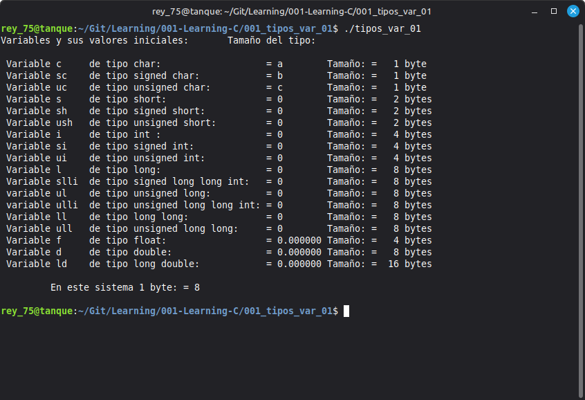

# 001 - Lesson Title

## Objective

## Objective

This program demonstrates the basic data types available in the C programming language and displays the size, in bytes, of each one.

A total of 18 variables representing the basic C data types were declared and initialized.

---

## Topics Covered

## Topics Covered

- Basic C data types
- Variable declarations
- Variable initialization
- The `sizeof` operator
- Signed and unsigned integer types
- Floating-point data types
- Character data types
- Printing values with `printf()`

---

## Requirements

- GCC Compiler
- Linux Mint 22.3 Cinnamon
- C17 Standard

---

## Source File

- tipos_var_01.c

---

## Compilation

```bash
gcc -Wall -Wextra -pedantic -std=c17 -o tipos_var_01 tipos_var_01.c
```

---

## Expected Output



---

## Notes

## Notes

This is a simple program designed to demonstrate the size, in bytes, of some of the basic data types available in the C programming language.

The program makes use of the `sizeof` operator and the `printf()` function to display the results. Overall, it is a straightforward example that is easy to understand and serves as a good introduction to C data types.

---

## Author

**Rey Hernandez**