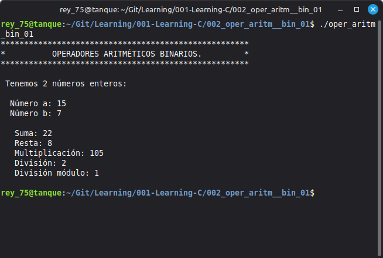

# 002 - Binary Aritmethic Operators with Integers

## Objective

Demonstrate the use of binary arithmetic operators in C, using integer variables.

---

## Topics Covered

    - int data type
    - Variable declaration and initialization
    - Binary arithmetic operators (+, -, *, /, %)
    - Integer arithmetic
    - printf() output

---

## Requirements

- GCC Compiler
- Linux Mint 22.3 Cinnamon
- C17 Standard

---

## Source File

- oper_aritm_bin_01.c

---

## Compilation

```bash
gcc -Wall -Wextra -pedantic -std=c17 -o oper_aritm_bin_01 oper_aritm_bin_01.c
```

---

## Expected Output



---

## Notes

    This program uses integer variables, so division produces an integer result.
    The modulo operator (%) returns the remainder of an integer division.

---

## Author

**Rey Hernandez**