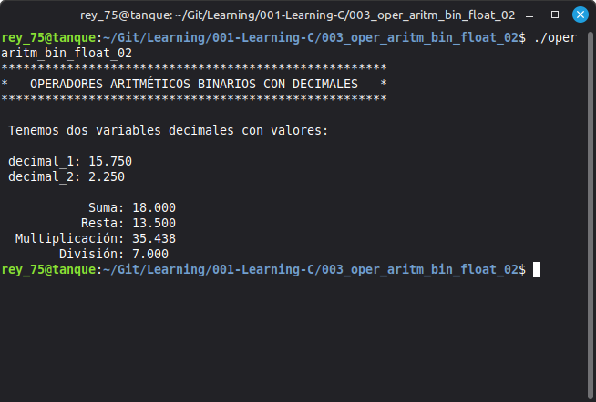

# 003: Binary Arithmetic Operators with Floating-Point Numbers

## Objective

Demonstrate the use of basic binary arithmetic operators (+, -, *, /) with floating-point numbers in C.

---

## Topics Covered

- float data type
- Variable declaration
- Variable initialization
- Binary arithmetic operators
- Addition
- Subtraction
- Multiplication
- Division
- Formatted output with printf

---

## Requirements

- GCC Compiler
- Linux Mint 22.3 Cinnamon
- C17 Standard

---

## Source File

- oper_aritm_bin_float_02.c

---

## Compilation

```bash
gcc -Wall -Wextra -pedantic -std=c17 -o program_name program_name.c
```

---

## Expected Output



---

## Notes

This program demonstrates the use of the four basic binary arithmetic operators with floating-point numbers in C. It performs addition, subtraction, multiplication, and division using two float variables and displays the results with formatted output.

---

## Author

**Rey Hernandez**