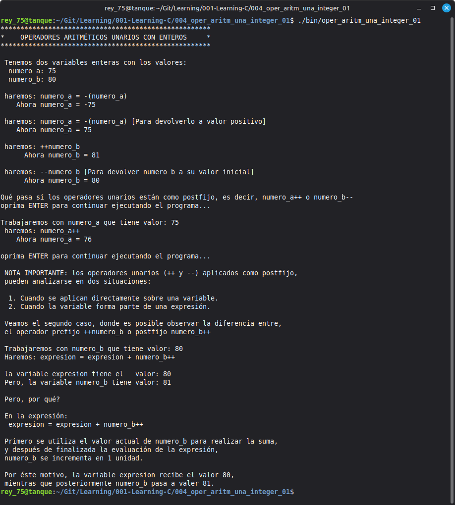

# 004 - Lesson Title

Unary Arithmetic Operators (Prefix and Postfix)

## Objective

Understand how unary arithmetic operators (+, -, ++, and --) work in C, including the difference between prefix and postfix forms, and observe their behavior when applied directly to variables and within simple arithmetic expressions.

---

## Topics Covered

- Unary arithmetic operators
- Unary plus (+)
- Unary minus (-)
- Prefix increment (++variable)
- Prefix decrement (--variable)
- Postfix increment (variable++)
- Postfix decrement (variable--)
- Unary operators in arithmetic expressions
- Difference between prefix and postfix operators

---

## Requirements

- GCC Compiler
- Linux Mint 22.3 Cinnamon
- C17 Standard

---

## Source File

- oper_aritm_una_integer_01.c

---

## Compilation

```bash
gcc -Wall -Wextra -pedantic -std=c17 -o program_name program_name.c
```

---

## Expected Output



---

## Notes

## Notes

This program introduces the unary arithmetic operators in C using simple and well-documented examples.

It demonstrates the behavior of the unary plus (+), unary minus (-), prefix increment (++variable), prefix decrement (--variable), postfix increment (variable++), and postfix decrement (variable--).

Special attention is given to the difference between prefix and postfix operators. The program explains why both forms appear to produce the same result when applied directly to a variable, and why their behavior becomes different when the variable is used as part of an arithmetic expression.

The objective is to provide beginners with a clear and progressive understanding of unary operators before moving on to more complex expressions.

---

## Author

**Rey Hernandez**