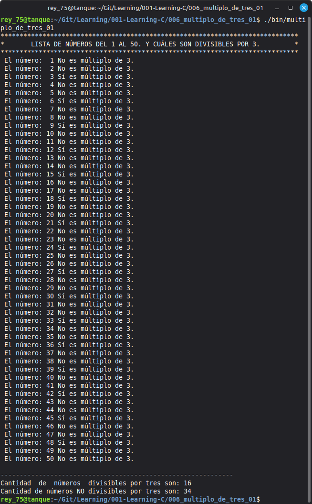

# 006 - Lesson Title 

006_multiplo_de_tres_01
Using the Modulus Operator (%) to Determine Divisibility.


## Objective

Develop a C program that displays the numbers from 1 to 50 and determines whether each number is divisible by 3 using the modulus operator (`%`). The program also counts how many numbers are divisible and not divisible by 3, displaying a summary at the end. This exercise reinforces the use of constants with `#define`, conditional statements (`if/else`), loops (`for`), counters, formatted output, and the modulus operator.

---

## Topics

- C program structure
- Preprocessor macros (`#define`)
- Integer variables
- Variable initialization
- The modulus operator (`%`)
- Comparison operator (`==`)
- Conditional statements (`if` / `else`)
- `for` loops
- Counters
- Formatted output with `printf()`
- Code documentation using comments

---

## Requirements

- GCC Compiler
- Linux Mint 22.3 Cinnamon
- C17 Standard

---

## Source File

- multiplo_de_tres_01.c

---

## Compilation

```bash
gcc -Wall -Wextra -pedantic -std=c17 -o program_name program_name.c
```

---

## Expected Output




---

## Notes

- ## Notes

- This program uses the modulus operator (`%`) to determine whether a number is divisible by 3.
- Two counters are used to keep track of divisible and non-divisible numbers.
- The output is formatted using `printf()` for improved readability.
- String macros (`#define`) are used instead of string literals to improve code organization and maintainability.
- This program is intended for learning purposes and demonstrates fundamental programming concepts in C.

---

## Author

**Rey Hernandez**